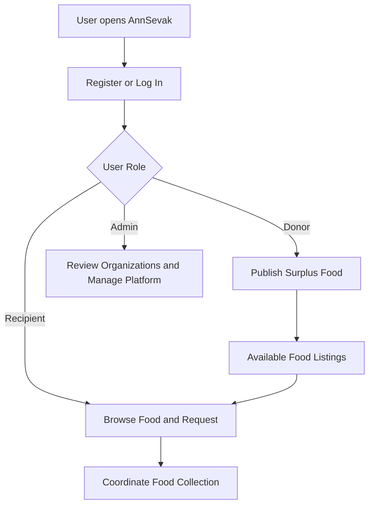

# 🌱 AnnSevak
### Food Rescue & Waste Reduction Platform

**Rescue surplus food. Connect communities. Reduce waste.**

A Java Spring Boot web application that connects food donors with recipient organizations, so usable surplus food reaches the people who need it instead of going to waste.

[▶️ Demo Video](#-project-demo-video) · [✨ Features](#-features) · [🧰 Tech Stack](#-technology-stack) · [🏗️ Application Flow](#%EF%B8%8F-application-flow)

---

## 📌 About the Project

Every day, perfectly usable food is thrown away while community organizations struggle to find enough support. **AnnSevak** bridges that gap with a simple, role-based platform:

- **Donors** publish details of their surplus food.
- **Recipients** discover available listings and request what they need.
- **Admins** verify organizations and keep the platform trustworthy.

> **Project goal:** Make surplus-food sharing easier, more organized, and more accessible.

## 👥 Who Uses AnnSevak?

| Role | What they can do |
|---|---|
| 🍽️ **Donor** | Register, publish surplus-food listings (name, type, quantity, dates, pickup details) |
| 🤝 **Recipient** | Browse available food, submit requests, coordinate collection |
| 🛡️ **Admin** | Review organization registrations, manage account status, handle complaints |

## ✨ Features

- 🔐 **Role-based access** for administrators, donors, and recipients
- 📝 **Registration and login** for organizations and platform users
- 🍲 **Donor food listings** with food name, type, quantity, dates, and pickup information
- 🔎 **Recipient food discovery** to browse available food and submit requests
- 🔄 **Food request workflow** to help coordinate collection
- 📣 **Complaint management** for reporting and reviewing issues
- 🧑‍💼 **Admin management tools** for reviewing registrations and managing account status
- 🔒 **Admin two-factor authentication (2FA)** using TOTP with QR-code support
- 📍 **Interactive location selection** on registration using Leaflet, OpenStreetMap, and the browser Geolocation API
- 🎨 **Thymeleaf-based pages** with HTML, CSS, and JavaScript

> *Feature availability may depend on the current project configuration. Test the workflows before presenting them as production-ready.*

## 🎬 Project Demo Video

[▶️ **Watch the AnnSevak Demo on Google Drive**](https://drive.google.com/drive/folders/1fm6wkDODcVYyef80hrWgeo_8yobLK3Ye)

> If the folder does not open the video directly, open the folder and select the demo video.

## 🧰 Technology Stack

| Layer | Technology |
|---|---|
| **Language** | Java |
| **Framework** | Spring Boot, Spring MVC |
| **Security** | Spring Security, TOTP / ZXing (admin 2FA) |
| **Persistence** | Spring Data JPA / Hibernate, MySQL |
| **Frontend** | Thymeleaf, HTML5, CSS3, JavaScript |
| **Maps** | Leaflet.js, OpenStreetMap, Browser Geolocation API |
| **Build** | Maven (with Maven Wrapper) |

## 🏗️ Application Flow

---

**AnnSevak: Surplus food ko waste hone se bachayein. 🌱**

Built with ❤️ by [Aditya Kumar](https://github.com/Adii995)

